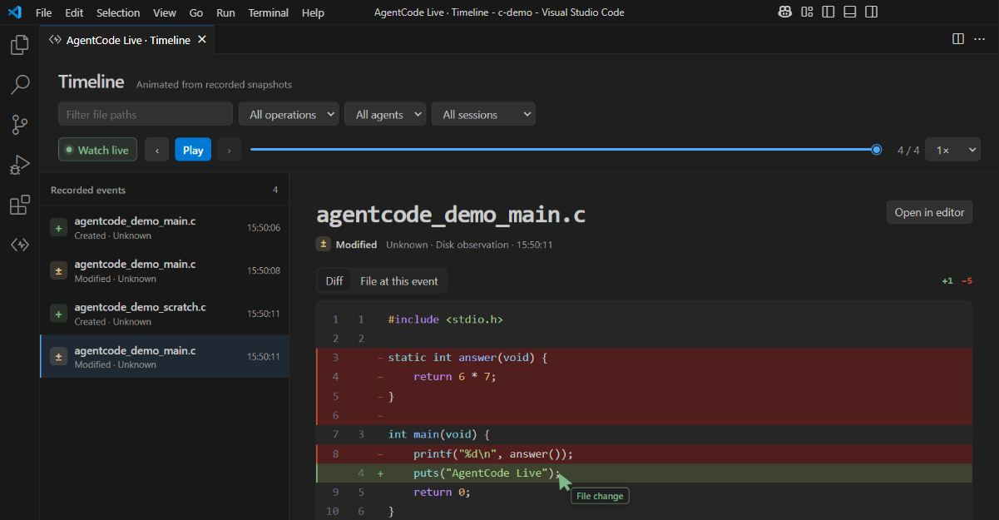

# AgentCode Live

**English** · [简体中文](README.zh-CN.md)

Watch AI coding agents build software, live.

AgentCode Live observes workspace files from VS Code and shows their captured changes in the editor, Explorer and a local timeline. It works with your existing Codex extension, Codex CLI, DeepSeek Harness and scripts.

## Install and try

1. Download the VSIX from [GitHub Releases](https://github.com/sanda-tt/agentcode-live/releases) and choose **Extensions → ⋯ → Install from VSIX**. VS Code 1.100 or later is required. For the current source features, run `npm ci` and `npm run package` from the repository root.
2. Open a trusted local folder and click **AgentCode Live** in the Activity Bar. Run your agent as usual or open [the C demo](examples/c-demo) as a VS Code folder.
3. Choose **Watch Changes Live** in the Activity view toolbar or Command Palette. Save a source file or run `node examples/play-demo.mjs` from the repository root. The timeline follows matching file changes and keeps earlier events available for review.

Enable **Follow Agent** from the Activity view toolbar to update a background editor and give manual typing priority. **Instant** decorates current disk contents. **Cinematic** animates one recorded diff in a read-only preview. Timeline can also animate history as you play it. Select an event or drag the playhead to leave live viewing and inspect a recorded version. All animation comes from snapshots and respects reduced-motion preferences.

The moving cursor and staged reveal take visual inspiration from [Swarm Rebuild](https://github.com/DhvanilPatel/swarm-cursors) and [Joel Califa’s Swarm](https://califa.github.io/swarm-site/).

[Animated C demo recorded in VS Code](docs/images/cursor-demo.gif) · [Explorer and live highlights](docs/images/editor-explorer.png) · [Native before/after diff](docs/images/editor-diff.png)

## Integrations

| Mode | What appears |
| --- | --- |
| Observer | Real disk snapshots, line counts, inferred external renames, Explorer N/M/R badges. Disk events show Unknown as their author. |
| Managed Codex | Native thread, turn, command and file-change status, per-file patch previews, turn diff notifications. [Codex guide](docs/codex.md) |
| DSH Cordis | Native session lifecycle, tool start and result in VS Code. The DSH Web session also has a live File activity tab for native file-tool results. [DeepSeek Harness guide](docs/dsh.md) |

The observer works independently of either native adapter. Use the native VS Code diff for character-level review.

## Settings

Run **AgentCode Live: Choose Extension Language** from the Command Palette, select **Follow VS Code**, **English**, or **简体中文**, then reload the window. You can also set `agentcodeLive.language` in user settings. The Command Palette names and Settings labels follow the [VS Code display language](https://code.visualstudio.com/docs/configure/locales). The **File activity** tab follows the DSH Web interface language.

| Setting | Default |
| --- | --- |
| `agentcodeLive.language` | `auto`; also accepts `en` and `zh-CN` |
| `agentcodeLive.enabled` | Workspace monitoring on |
| `agentcodeLive.follow` | Off |
| `agentcodeLive.mode` | `instant`; choose `cinematic` for animated follow |
| `agentcodeLive.animationLinesPerSecond` | 40 |
| `agentcodeLive.addedColor` | VS Code theme color; use a hex value to override |
| `agentcodeLive.history` | Local persistence on |
| `agentcodeLive.maxHistoryMiB` | 24 MiB, up to 3,000 retained events |
| `agentcodeLive.maxFileKiB` | 256 KiB per UTF-8 text file |
| `agentcodeLive.ignore` | Extra gitignore-style patterns |
| `agentcodeLive.codexExecutable` | `codex` on PATH |

Use **Start a New Observer Session** when beginning a task. **Pause or Resume Live View** freezes the Activity tree and background follow, while recording continues at the configured retention. Turn off `history` to stop persisting new snapshots. Use **Clear Local History** to erase stored snapshots. The bounded timeline can still display current-window events with persistence disabled.

## Troubleshooting and limits

- For missing changes, open a trusted local folder and check settings, UTF-8 encoding, file size, built-in exclusions and nested `.gitignore`. Symlinks and common build, dependency and credential paths are excluded. A first change may have only an after snapshot if the baseline was unavailable.
- File watchers may merge fast writes and missed intermediate contents cannot be reconstructed. An atomic replacement usually produces one file change. A same-content rename outside VS Code can be inferred only when both sides are captured together.
- Because local history contains captured source and per-file patches, exclude project-specific sensitive paths or disable persistence as appropriate. Views and playback use copies of captured data.
- See **Output → AgentCode Live** for observation and connection errors. The project targets local Windows workflows. VS Code Marketplace distribution is on the roadmap.

[Architecture](docs/architecture.md) · [Verification](docs/verification.md) · [Contributing](CONTRIBUTING.md) · [MIT license](LICENSE)
