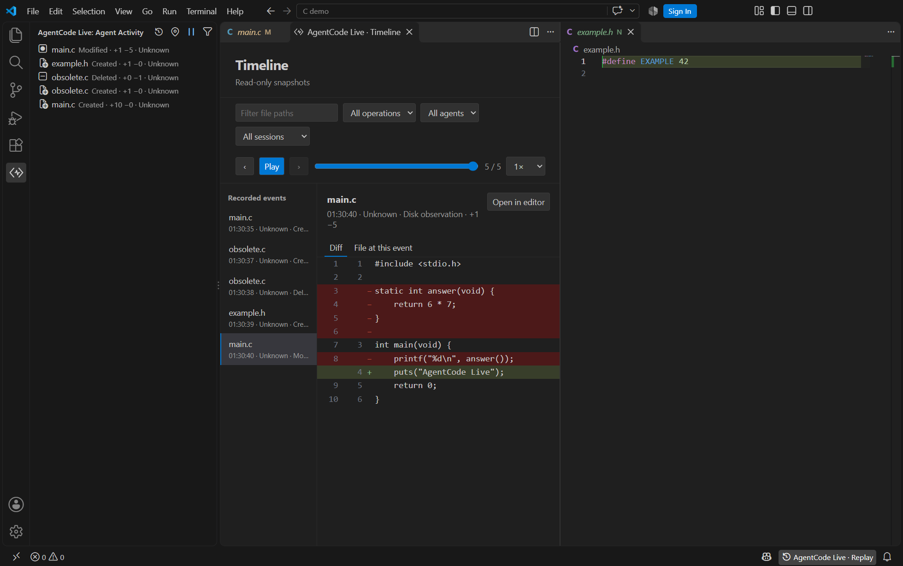

# AgentCode Live

像观看真人远程编程一样，实时观察 AI Agent 修改项目。

AgentCode Live 在 VS Code 中观察工作区落盘变化，用原生编辑器、资源管理器和本地时间线展示源码版本。你可以继续使用原来的 Codex 工作方式，也可以用任何外部脚本写入文件。 [English](README.md)

## 安装与体验

1. 在 [GitHub Releases](https://github.com/sanda-tt/agentcode-live/releases) 下载 VSIX。打开 VS Code 的「扩展 → … → 从 VSIX 安装」。需要 VS Code 1.100 或更新版本。
2. 打开受信任的本地目录，点击左侧 **AgentCode Live**。直接让 Agent 修改代码，或单独打开 [C 示例](examples/c-demo)。
3. 若用示例，在仓库根目录执行 `node examples/play-demo.mjs`。点活动记录查看新增和删除，点活动栏顶部的时钟打开时间线。

在活动视图工具栏切换自动跟随。开启时会更新后台编辑器，手动编辑优先。即时模式在实际文件上显示高亮，动态模式在只读视图中按行播放已经得到的差异。时间线支持拖动、逐步、暂停、速度调节及文件、操作、Agent、会话筛选。

## Agent 接入

- **普通 Codex 扩展或 CLI**直接使用观察模式。活动中的磁盘事件标记为「未知」，已有扩展的私有会话无需改动。
- **托管 Codex**由本扩展开启独立 App Server，会显示原生任务轮次、命令状态、文件差异和轮次差异更新。[Codex 接入指南](docs/codex.md)
- **DeepSeek Harness**通过原生 Cordis 插件将工具开始、工具结果和会话状态推送到 VS Code。磁盘前后快照由工作区观察器独立捕获。[DSH 安装与排查](docs/dsh.md)

## 设置与排查

在 VS Code 设置中搜索 `AgentCode Live`。可以调整监听开关、跟随、即时或动态模式、动画速度、新增行颜色、历史开关与容量、最大文件大小，以及附加忽略规则。默认每个 UTF-8 文件上限为 256 KiB，历史为 24 MiB 且最多 3,000 条。界面跟随 VS Code 的中文或英文语言设置。

- 用「新建观察会话」切换记录范围。暂停实时视图会冻结活动树和跟随。记录继续，Agent 也继续运行。
- 历史保存在工作区对应的本地 VS Code 存储中，可能包含源码和差异。关闭历史设置停止后续持久化。用「清除本地历史」删除已有记录。关闭持久化时，当前窗口仍可查看有容量上限的临时记录。
- 连续快速写入可能合并为一次快照。基线缺失时只显示首次读到的文件状态。磁盘上的外部重命名根据同批次的唯一相同内容配对推断，界面会注明。
- 看不到变更时检查工作区信任、本地路径、文件大小、UTF-8 编码和忽略规则。依赖、产物、常见凭据文件和符号链接默认排除。查看「输出 → AgentCode Live」定位连接和监听问题。
- DSH Web 内嵌面板、历史导出和 Marketplace 分发属于后续版本。

[架构](docs/architecture.md) · [验证结果](docs/verification.md) · [项目许可证](LICENSE)
